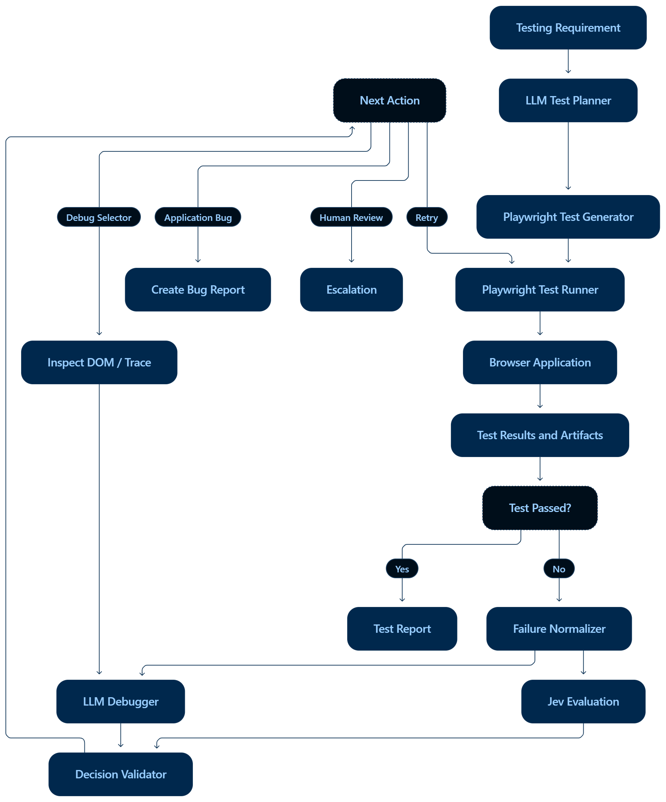
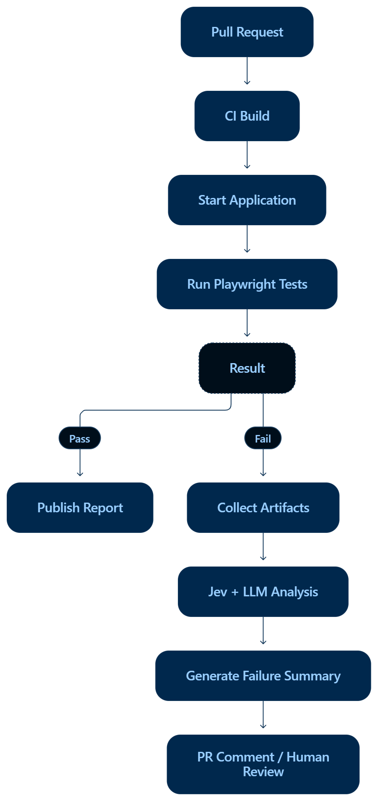

The previous document included Playwright, but it wasn't exclusively Playwright-focused—it covered general AI agent architecture, Jev, and repository integration. This revised document will use Playwright as the core browser automation framework from test generation through execution, failure analysis, and Jev-based decision-making.

Jev-Integrated Playwright AI Testing Agent
Playwright-Centered Technical Design
AI Testing Agent with Playwright + Jev

A practical architecture for generating, executing, evaluating, and debugging browser automation tests in local repositories and CI/CD.

Detailed planning checklist: [plan.md](plan.md). The implemented CLI application and run instructions are in [README.md](README.md). See [IMPLEMENTATION_CHECKLIST.md](IMPLEMENTATION_CHECKLIST.md) for verification and the remaining live provider/target setup.

Browser automation: Playwright

AI: ChatGPT / Claude / other LLM

Decision layer: Jev (subject to API verification)

Target: Local web application repositories

1. Project Objective

Build an AI-powered testing agent that uses Playwright to interact with web applications and Jev to evaluate test outcomes and make structured decisions.

The agent should be able to:

Read a testing requirement.

Generate Playwright test scripts.

Run tests in Chromium, Firefox, or WebKit.

Capture screenshots, traces, and errors.

Analyze failures using an LLM and Jev.

Decide whether to retry, investigate, or escalate.

Generate a testing report.

Technology Stack

Component

	

Technology

Browser automation

	

Playwright

Test framework

	

Playwright Test

AI test generation

	

LLM

Structured evaluation

	

Jev

Backend / orchestration

	

Python or TypeScript

Target applications

	

Angular, Next.js, React, etc.

CI/CD

	

GitHub Actions / Jenkins

Core principle

Playwright is the execution engine. Jev is an evaluation component, and the LLM is responsible for tasks requiring test generation or deeper debugging.

3. Complete Playwright Workflow

### Agent workflow diagram

The passing path produces a test report. On failure, the Failure Normalizer supplies evidence to Jev Evaluation and the LLM Debugger. Their outputs feed the Decision Validator, which selects the next action: retry, selector investigation, application bug report, or human review. Selector investigation loops through DOM/trace inspection and the LLM Debugger before another validated decision.

The diagram is conceptual: the implementation plan must define when evaluation and debugging run, how a proposed correction is validated before retry, and when the loop stops. See [plan.md](plan.md) for these decisions and the detailed checklist.

Step 1: User provides a requirement

Example:

Test the login functionality of my application. Verify successful login and invalid password handling.

The agent should identify:

Application URL.

Required test scenarios.

Authentication requirements.

Expected results.

Test data requirements.

Step 2: LLM generates Playwright tests

Example generated test:

import { test, expect } from "@playwright/test";

test("valid login", async ({ page }) => {
  await page.goto("/login");

  await page.getByLabel("Email").fill("test@example.com");
  await page.getByLabel("Password").fill("password");

  await page.getByRole("button", { name: "Login" }).click();

  await expect(page).toHaveURL(/dashboard/);
});

The agent should validate the generated test before execution.

Step 3: Playwright executes the test
npx playwright test

The Playwright runner manages browser launch, navigation, actions, assertions, and test lifecycle.

Step 4: Capture execution artifacts

Configure Playwright to capture evidence useful for AI debugging:

import { defineConfig } from "@playwright/test";

export default defineConfig({
  use: {
    trace: "retain-on-failure",
    screenshot: "only-on-failure",
    video: "retain-on-failure",
  },
});

These settings are illustrative. Video and trace retention should be tuned for your CI storage and privacy requirements.

Step 5: Analyze the result

If the test fails, collect:

Test title.

Error message.

Stack trace.

URL.

Browser.

Screenshot.

Trace path.

Test source.

Retry count.

Step 6: Send structured information to Jev

Jev evaluates questions such as:

Is this likely a selector issue?
Is retry appropriate?
Is this an application defect?

Use the verified current API schema when implementing the actual request.

Step 7: Execute the next action

The orchestrator chooses an allowed action using the evaluation and explicit rules.

4. Playwright Test Runner Integration
4.1 Project structure
Test-Agent/
│
├── agents/
│   ├── test_agent.py
│   ├── planner.py
│   └── debugger.py
│
├── playwright/
│   ├── test_generator.py
│   ├── test_runner.py
│   ├── result_parser.py
│   └── playwright.config.ts
│
├── integrations/
│   └── jev_client.py
│
├── evaluators/
│   └── failure_triage.py
│
├── policies/
│   └── retry_policy.py
│
├── tests/
│   └── integration/
│
├── .env.example
├── requirements.txt
└── README.md

This is a suggested structure. Adapt it to your existing repository rather than creating duplicate Playwright executors.

4.2 Base URL configuration

For a local application:

import { defineConfig } from "@playwright/test";

export default defineConfig({
  use: {
    baseURL: process.env.TARGET_BASE_URL || "http://localhost:3025",
  },
});

Run the application first:

cd D:\My-Application
pnpm dev

Then run the agent or Playwright tests from your Test-Agent repository.

5. Failure Collection
Example Playwright failure
Test: User login

Error:
Timeout waiting for getByRole("button", { name: "Login" })

URL:
http://localhost:3025/login

Expected:
Login button should be visible

Actual:
Element was not found
Normalized failure object
failure_state = {
    "framework": "playwright",
    "test_name": "User login",
    "status": "failed",
    "error_type": "TimeoutError",
    "error_message": (
        'Timeout waiting for getByRole("button", '
        '{ name: "Login" })'
    ),
    "url": "http://localhost:3025/login",
    "browser": "chromium",
    "retry_count": 0,
    "artifacts": {
        "screenshot": "artifacts/login-failure.png",
        "trace": "artifacts/login-failure.zip",
    },
}

Implementation note: The error parser should extract actual metadata from Playwright's test results instead of relying on hardcoded examples.

6. Jev Evaluation for Playwright
6.1 Failure categories

Create a classification system specifically for browser test failures.

Category

	

Example

SELECTOR

	

Locator doesn't match any element

TIMEOUT

	

Page or element takes too long

ASSERTION

	

Actual UI differs from expected

NETWORK

	

API request fails

AUTHENTICATION

	

Session or login problem

ENVIRONMENT

	

Server unavailable

TEST_DATA

	

Missing test data

UNKNOWN

	

Insufficient evidence

A timeout is not automatically a transient issue. The agent should inspect evidence and distinguish between slow rendering, missing elements, and application defects.

6.2 Structured questions

Define a question for primary failure category:

Question:
Classify the primary cause of this Playwright failure.

Allowed categories:
- SELECTOR
- TIMEOUT
- ASSERTION
- NETWORK
- AUTHENTICATION
- ENVIRONMENT
- TEST_DATA
- UNKNOWN

Define a separate retry question:

Question:
Is retrying this Playwright test an appropriate next step?

The actual Jev question syntax and response format must be confirmed from the current API documentation.

7. Playwright-Specific Debugging Agent

This is where the combination becomes useful.

Example workflow: Selector failure

1. Playwright test fails

locator("button#login") not found

2. Jev classifies failure

Likely selector issue → route to selector investigation.

3. Agent inspects evidence

Playwright screenshot.

Trace viewer.

Page DOM or accessible snapshot.

Test source.

4. LLM proposes a fix

page.getByRole("button", { name: "Login" })

5. Validate and rerun

Run the corrected test in a controlled worktree or approved environment.

Jev can help select the investigation route, but the LLM and Playwright evidence are still required to determine whether a selector change is actually correct.

8. Retry Policy for Playwright

Never let the AI retry tests indefinitely.

MAX_RETRIES = 2

def next_action(
    failure_type: str,
    retry_count: int,
) -> str:
    if retry_count >= MAX_RETRIES:
        return "HUMAN_REVIEW"

    if failure_type == "ENVIRONMENT":
        return "CHECK_ENVIRONMENT"

    if failure_type == "SELECTOR":
        return "DEBUG_SELECTOR"

    if failure_type == "NETWORK":
        return "INVESTIGATE_NETWORK"

    return "LLM_INVESTIGATION"

This version uses a deterministic routing policy. You can later incorporate Jev's evaluated result into the policy after validating the API output.

Playwright retry considerations

Use Playwright's built-in retry configuration for known test-runner retry needs.

Keep agent-level retries separate from Playwright's internal retries.

Track total attempts across both layers.

Do not classify a test as healthy merely because it passes on retry.

Preserve the original failure artifact.

9. Using the Agent with Your Local Repository
9.1 Two repository setup
D:\Test-Agent
D:\My-Application

The target application might be your Angular, Next.js, or other web application.

9.2 Workflow
# Terminal 1
cd D:\My-Application
pnpm dev
# Terminal 2
cd D:\Test-Agent
.venv\Scripts\activate
python main.py

The actual entry point depends on your repository.

9.3 What the agent needs

Capability

	

Purpose

Target URL

	

Navigate to the application

Playwright browser

	

Execute browser actions

Source access

	

Inspect relevant code if needed

Test output

	

Capture failures

LLM credentials

	

Generate and debug tests

Jev credentials

	

Evaluate defined questions

Permissions

	

Control source modifications

You should not assume that cloning the Test-Agent repository automatically gives it permission to inspect or modify another repository. Configure that access explicitly.

10. Testing the Integration
10.1 Unit tests

Test the following independently:

Jev response parsing.

Failure classification handling.

Retry policy.

Invalid response behavior.

API timeout handling.

10.2 Playwright integration tests

Use a small test application with known behaviors:

1. Working login button
2. Missing login button
3. Slow API response
4. Failed network request
5. Incorrect expected text

For each case, record the actual failure and expected classification.

10.3 Evaluation metrics

Metric

	

Measurement

Failure classification accuracy

	

Correct category / total

Retry appropriateness

	

Suitable retry decisions

Selector repair success

	

Corrected tests that pass

False repair rate

	

Incorrect fixes proposed

Execution latency

	

Time per test / evaluation

API usage

	

Requests and token consumption

Use labeled data to evaluate Jev, and compare against an LLM-only baseline.

11. CI/CD Integration

Once the local integration works, connect it to your CI pipeline

### CI/CD workflow diagram

This diagram places the testing agent inside the pull-request pipeline. Passing tests publish a report; failing tests preserve artifacts, receive Jev and LLM analysis, and produce a failure summary for a PR comment or human review. Build failures, startup failures, and unavailable analysis services need explicit handling in the implementation plan.

Both diagram images are stored in `docs/diagrams/` and linked with relative paths, so the Markdown does not depend on the original Downloads folder. Use Markdown Preview in your editor to display them.

The CI agent should not automatically modify or merge source code based solely on a model decision.

12. Implementation Roadmap
Playwright + Jev milestones

Phase 1 — Playwright baseline

Run existing tests locally, configure base URL, and collect artifacts.

Phase 2 — LLM test generation

Generate Playwright test files and validate their syntax and structure.

Phase 3 — Jev proof of concept

Verify the provider API, test one evaluation question, and validate the response.

Phase 4 — Failure triage

Normalize Playwright failures and route them through Jev.

Phase 5 — Debugging and controlled retry

Add trace inspection, LLM debugging, retry limits, and validation.

Phase 6 — CI/CD

Run the agent against pull requests with reporting and controlled permissions.

13. Final Target System

The complete Playwright-centered agent should work like this:

Example: Automated login test debugging
Developer provides login testing requirement.
LLM generates Playwright test code.
Playwright launches Chromium and executes the test.
Test fails and the agent collects a screenshot, trace, and error.
Jev evaluates the failure category and retry suitability.
LLM investigates the selector using Playwright evidence.
Policy engine validates the proposed action.
Agent reruns the corrected test or escalates for review.
Final result is stored in a report.

This is the Playwright-specific version of the architecture. The actual Jev client, test result parser, and integration files should be implemented against the current Jev API specification and your repository's existing code.

